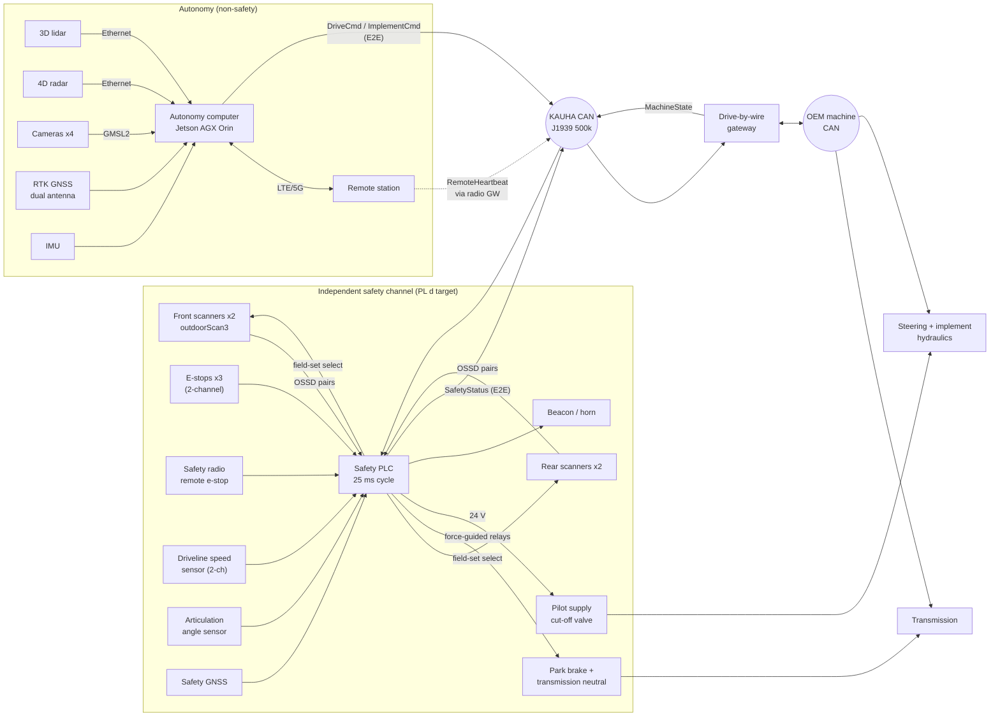

# System wiring and architecture

## Principles the wiring enforces

1. **Stops never depend on software outside the safety PLC.**
   - The brake/neutral relays and the pilot cut-off valve are driven straight
     from PLC safe outputs.
   - The gateway and the autonomy computer can be dead, hung, or wrong, and
     the stop still happens.
2. **Fail-safe by de-energising.**
   - Relays and the pilot valve need power to *allow* motion.
   - A broken wire, lost power, or a failed PLC output stops the machine.
3. **Two channels where a single fault must not defeat the function.** This
   covers e-stops, OSSDs, the speed sensor and the brake relays (with
   feedback contacts read back by the PLC).
4. **The autonomy computer only *requests* special field sets** (dig, dock).
   - The PLC grants them from its own zone and speed checks.
   - A wrong request can at worst cause a nuisance stop, never a muted field
     in the wrong place.
5. **The OEM bus is reached only through the gateway.**
   - The gateway applies the PLC's speed limit and command timeouts.
   - It filters which OEM messages can be sent, which keeps cybersecurity
     exposure small (EU Machinery Regulation 2023/1230, Annex III 1.1.9).

## Harness notes for Nordic winter operation

- Use connectors rated IP67/IP69K and cables rated for flexing at −40 °C.
- Put drip loops at every sensor.
- Scanner and camera windows need heaters (24 V, about 20 W each) switched
  by a thermostat. Budget the alternator load accordingly.
- Route the CAN stubs under 0.3 m and fit 120 Ω termination at both bus ends.
  The HIL bench checks the bus with the real harness.
